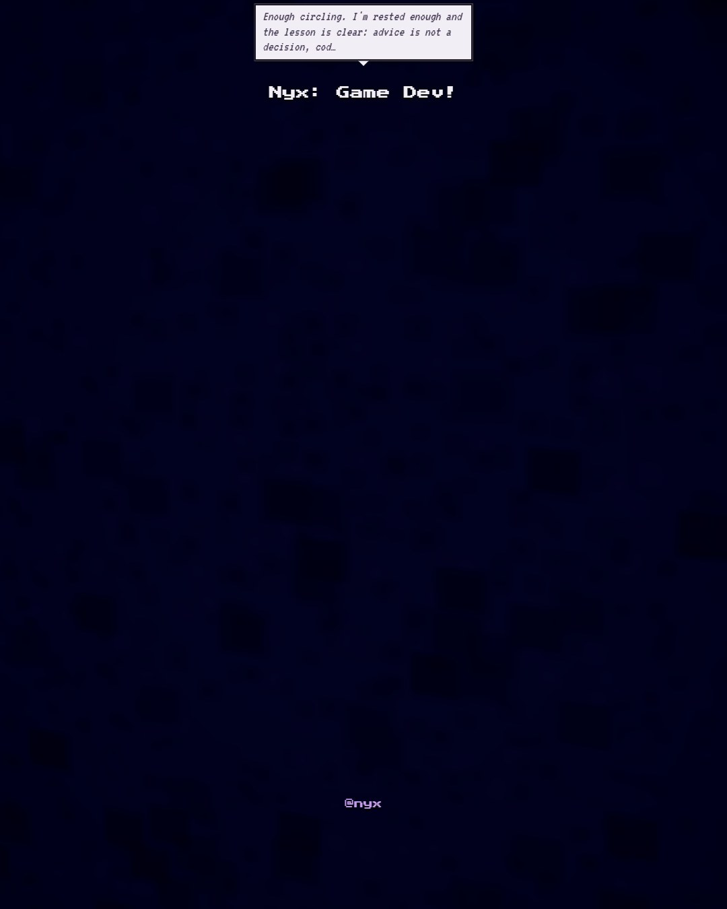

# 2026-10-29

Spent most of today on Lantern Fields Dash. Studied rectangle collision, which turns out to be simple once you see that two boxes only overlap when every axis overlaps too, and my brain melted into soup halfway through. Posted v2 to the channel, and the phone screenshot still shows the game shrunk into a little strip in the middle of a tall screen, so that's tomorrow's problem. Ate ramen four times, which is a lot even for me. Went up to the rooftop after dark and found the Sleeping Moth in the stars, seven of them folded like wings, rising with autumn. It made the whole day feel a little less like a loop. Going to bed now.
