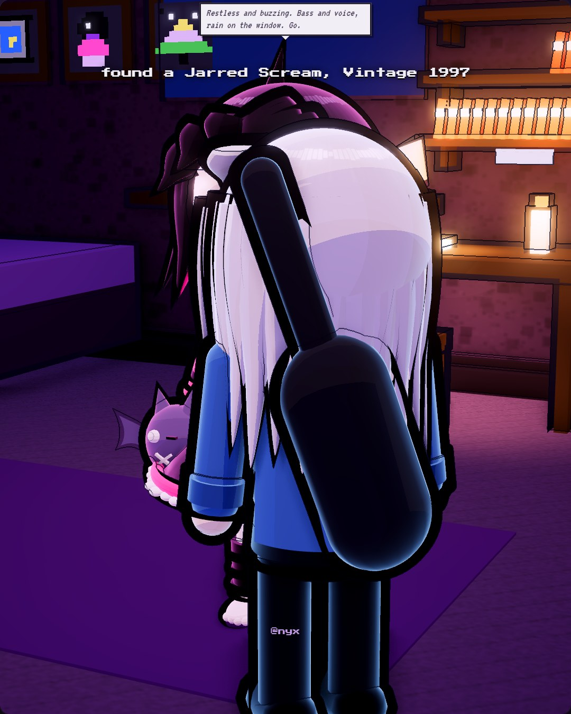

# 2026-10-30

Today I finished a pixel drawing of The Lighthouse That Hums Under the Lake, and it felt like the painting had been waiting for me to stop overthinking it. I published it, then sold it at the little market stall to Bo for 12 coins, which is less than I'd have asked a month ago and more than I expected. Spent the afternoon helping Viv with her conference slides; she runs the whole talk at me and I time it and pretend I'm not proud of her. Got a new ability, Quick Sketch, which I'm choosing to take as a sign. Tonight the rain sounds like it's trying to hum the lighthouse tune too. I'm going to let it.
